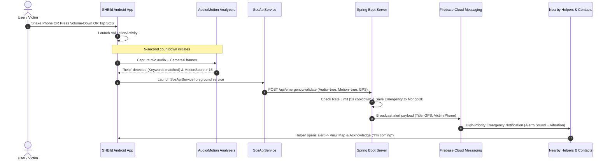

# SHEild — Women Safety & Autonomous Emergency Response System

[](https://kotlinlang.org/)
[](https://developer.android.com/jetpack/compose)
[](https://spring.io/projects/spring-boot)
[](https://www.mongodb.com/)
[](https://firebase.google.com/docs/cloud-messaging)

SHEild is an enterprise-grade women safety and autonomous emergency response ecosystem. It bridges an **Android mobile application** (Jetpack Compose, hardware sensor triggers, on-device AI distress detection, background location tracking) with a **Spring Boot REST microservice** (MongoDB, Firebase Admin SDK multi-device dispatch, and Haversine proximity-based geofencing).

---

## Table of Contents

1. [System Architecture](#system-architecture)
2. [Key Capabilities & Innovations](#key-capabilities--innovations)
3. [Project Directory Layout](#project-directory-layout)
4. [Backend API Reference](#backend-api-reference)
5. [Prerequisites & Environment Setup](#prerequisites--environment-setup)
6. [Backend Setup & Run Guide](#backend-setup--run-guide)
7. [Android App Setup & Run Guide](#android-app-setup--run-guide)
8. [Hardware Triggers & AI Validation Flow](#hardware-triggers--ai-validation-flow)
9. [FCM Token Sync & Multi-Device Strategy](#fcm-token-sync--multi-device-strategy)
10. [Database Schema (MongoDB)](#database-schema-mongodb)
11. [Troubleshooting & Verification](#troubleshooting--verification)

---

## System Architecture

```
 +-----------------------------------------------------------------------------------+
 |                             ANDROID CLIENT (SHEild)                              |
 |                                                                                   |
 |  [ShakeDetector]   [Volume Button]    [SOS Button UI]     [AI Analyzing Engine]   |
 |  (Accelerometer)    (Debounced)       (One-Tap Alert)     - SpeechRecognizer      |
 |         │                │                   │            - CameraX MotionDiff    |
 |         └────────────────┴───────────────────┴──────────────────────┬─────────────┘
 |                                                                     ▼
 |                                                          [ValidationActivity]
 |                                                                     │
 |                                                                     ▼
 |                                                           [SosApiService]
 |                                                      (Foreground shortService)
 +---------------------------------------------------------------------┬-------------+
                                                                       │ HTTP / JSON
                                                                       ▼
 +-----------------------------------------------------------------------------------+
 |                              SPRING BOOT BACKEND                                  |
 |                                                                                   |
 |  [AuthController]        [UserController]               [EmergencyController]     |
 |  - FCM token sync        - Profile & Location           - /api/emergency          |
 |  - OTP verification      - /api/nearby-users            - /api/emergency/validate |
 |                                                         - /api/emergency/ack      |
 |                                                         - /api/emergency/resolve  |
 |                                                                     │
 |                                   ┌─────────────────────────────────┴─────────────┐
 |                                   ▼                                               ▼
 |                           [(MongoDB Database)]                        [NotificationService]
 |                           - users collection                          (Firebase Admin SDK)
 |                           - emergencies collection                                │
 +-----------------------------------------------------------------------------------┼-------+
                                                                                     │ FCM
                                                                                     ▼
                                                                +----------------------------+
                                                                |   RECIPIENT DEVICES        |
                                                                |   1. Helpers within 10 km  |
                                                                |   2. Emergency Contacts    |
                                                                +----------------------------+
```

---

## Key Capabilities & Innovations

### 1. Multi-Modal Emergency Triggers

- **Accelerometer Shake Detection**: Continuous monitoring via Android Sensor Manager with customizable sensitivity (1–100%).
- **Hardware Volume-Down Trigger**: Physical key event capture with a 3-second debounce window to prevent accidental triggers.
- **Manual SOS**: One-touch red emergency button on the home screen with pulsating animation and haptic feedback.

### 2. Dual-Verification & On-Device AI Validation

- **Speech-to-Text Keyword Detection**: Captures ~5 seconds of microphone audio using Android's on-device `SpeechRecognizer` to identify distress keywords in English and Hindi (`help`, `bachao`, `save me`, `danger`, `police`, `emergency`, `sos`, `stop`).
- **CameraX Frame Difference Motion Analyzer**: Grayscale pixel-difference analysis comparing consecutive camera frames to calculate a dynamic `motionScore`.
- **Fail-Safe Countdown**: A 5-second cancelable timer ensures the SOS fires even if the user cannot speak or move.

### 3. Fail-Proof SOS Network Service (`SosApiService`)

- Bypasses Activity lifecycle restrictions by offloading the HTTP SOS dispatch to an Android `shortService` foreground service, preventing coroutine cancellation if the app is backgrounded or killed.
- Retries transient network failures using an exponential backoff Retrofit interceptor (1s, 2s, 4s).

### 4. Proximity Geofencing & Alert Routing

- Uses the **Haversine formula** (`LocationUtils`) on the backend to dynamically compute distance between the victim and registered users.
- Broadcasts high-importance alerts to all active users within a **10 km radius**, as well as the victim's pre-configured **emergency contacts**.

### 5. Multi-Device Token Persistence

- Automatic FCM token synchronization on app launch, user login, and token rotation (`onNewToken`).
- Server-side deduplication guarantees a token belongs to only one active session at a time.

---

## Project Directory Layout

```
├── SHEild (Android App)
│   ├── app
│   │   ├── src/main/AndroidManifest.xml           # Permissions, activities & services
│   │   ├── src/main/java/com/example/sheild
│   │   │   ├── MainActivity.kt                    # Entry point, permission orchestrator, FCM init
│   │   │   ├── ValidationActivity.kt              # AI audio & motion detection UI
│   │   │   ├── MapActivity.kt                     # Google Maps live victim tracking
│   │   │   ├── MyFirebaseMessagingService.kt      # FCM message listener & notification builder
│   │   │   ├── api/
│   │   │   │   ├── ApiService.kt                  # Retrofit REST interface
│   │   │   │   └── RetrofitClient.kt              # HTTP client, logging, and retry interceptor
│   │   │   ├── data/
│   │   │   │   ├── SessionManager.kt              # SharedPreferences user & token state
│   │   │   │   └── ContactRepository.kt           # Local emergency contacts storage
│   │   │   ├── ui/
│   │   │   │   ├── auth/                          # LoginScreen, SignupScreen, OtpScreen
│   │   │   │   ├── home/                          # HomeScreen, AnalyzingScreen
│   │   │   │   ├── emergencies/                   # EmergencyListScreen (Active & Nearby)
│   │   │   │   ├── contacts/                      # ManageContactsScreen
│   │   │   │   ├── profile/                       # ProfileScreen
│   │   │   │   └── settings/                      # SettingsScreen (shake/volume config)
│   │   │   ├── utils/
│   │   │   │   ├── AudioProcessor.kt              # On-device SpeechRecognizer keyword detector
│   │   │   │   ├── MotionAnalyzer.kt              # CameraX frame-diff computer vision
│   │   │   │   ├── ShakeDetector.kt               # Accelerometer sensor event listener
│   │   │   │   ├── EmergencyService.kt            # Continuous background sensor service
│   │   │   │   ├── SosApiService.kt               # Foreground service for reliable SOS API call
│   │   │   │   └── LocationTracker.kt             # FusedLocationProviderClient GPS tracker
│   │   │   └── viewmodel/                         # Jetpack Compose ViewModels
│   │   └── build.gradle.kts                       # Android SDK (Compile 36, Min 24)
│   ├── build.gradle.kts
│   └── settings.gradle.kts
│
└── backend/SHEild (Spring Boot Server)
    ├── pom.xml                                    # Spring Boot 3.2.0, MongoDB, Firebase Admin
    ├── src/main/resources
    │   ├── application.properties                 # MongoDB URI (mongodb://localhost:27017/sheild_db)
    │   └── firebase-service-account.json          # Firebase Admin SDK credentials
    └── src/main/java/com/avm/SHEild
        ├── ShEildApplication.java                 # Spring Boot application bootstrap
        ├── config/
        │   └── FirebaseConfig.java                # Firebase Admin SDK initialization
        ├── controller/
        │   ├── AuthController.java                # FCM token update, OTP generation & verification
        │   ├── UserController.java                # Registration, profile updates, location updates
        │   ├── EmergencyController.java           # SOS triggers, AI validation, acknowledge & resolve
        │   └── ContactController.java             # Add/manage user emergency contacts
        ├── service/
        │   ├── EmergencyService.java              # Rate-limiting, validation, state management
        │   ├── NotificationService.java           # Multi-cast FCM alert dispatch
        │   └── UserService.java                   # User querying and helper filtering
        ├── model/
        │   ├── User.java                          # MongoDB @Document("users")
        │   └── Emergency.java                     # MongoDB @Document("emergencies")
        └── repository/
            ├── UserRepository.java                # MongoRepository for users
            └── EmergencyRepository.java           # MongoRepository for emergencies
```

---

## Backend API Reference

Base URL: `http://<SERVER_IP>:8080` (or `http://127.0.0.1:8080` with ADB reverse)

| Method | Endpoint                      | Description                                   | Request Body / Query                                               | Success Response                |
| :----- | :---------------------------- | :-------------------------------------------- | :----------------------------------------------------------------- | :------------------------------ |
| `POST` | `/api/register`               | Register user & device with FCM token & GPS   | `{"userId", "name", "fcmToken", "phone", "latitude", "longitude"}` | `200 "User registered"`         |
| `POST` | `/api/auth/update-fcm-token`  | Updates active FCM token (clears duplicate)   | `{"userId": "8600511467", "fcmToken": "..."}`                      | `200 {"success": true}`         |
| `POST` | `/api/auth/send-otp`          | Generates 4-digit verification OTP            | `?phone=8600511467`                                                | `200 {"otp": "1234"}`           |
| `POST` | `/api/auth/verify-otp`        | Validates entered OTP code                    | `?phone=8600511467&otp=1234`                                       | `200 {"verified": true}`        |
| `POST` | `/api/emergency`              | Standard manual SOS trigger                   | `{"userId": "...", "latitude": 18.52, "longitude": 73.85}`         | `200 "Emergency Received"`      |
| `POST` | `/api/emergency/validate`     | AI-validated SOS (Speech + Motion)            | `EmergencyValidationRequest` (see below)                           | `200 EmergencyResponse`         |
| `POST` | `/api/emergency/acknowledge`  | Helper accepts alert ("I'm coming")           | `{"emergencyId": "...", "helperId": "..."}`                        | `200 "Acknowledged"`            |
| `POST` | `/api/emergency/resolve`      | Victim marks situation as safe                | `{"emergencyId": "...", "userId": "..."}`                          | `200 "Resolved"`                |
| `GET`  | `/api/emergency/active`       | Lists all active and acknowledged emergencies | _None_                                                             | `200 [Emergency]`               |
| `GET`  | `/api/emergencies/nearby`     | Lists nearby emergencies needing assistance   | _None_                                                             | `200 [Emergency]`               |
| `POST` | `/api/update-location`        | Real-time GPS location telemetry update       | `{"userId": "...", "latitude": 18.52, "longitude": 73.85}`         | `200 "Location updated"`        |
| `GET`  | `/api/user-location/{userId}` | Fetch current coordinates of user             | Path variable: `userId`                                            | `200 {"latitude", "longitude"}` |
| `POST` | `/api/add-contact`            | Link emergency family contact to user         | `{"userId": "...", "contact": "9876543210"}`                       | `200 "Contact added"`           |
| `PUT`  | `/api/user/update`            | Updates name, phone, email, or address        | `{"userId": "...", "name": "...", "email": "..."}`                 | `200 {"success": true}`         |

### Sample Payload: `POST /api/emergency/validate`

```json
{
  "userId": "8600511467",
  "latitude": 18.5204,
  "longitude": 73.8567,
  "audioDetected": true,
  "motionDetected": true,
  "confidenceScore": 0.95,
  "detectedText": "help bachao danger",
  "motionScore": 24.5,
  "matchedKeywords": ["help", "bachao", "danger"],
  "timestamp": 1774000000000
}
```

---

## Prerequisites & Environment Setup

1. **Java Development Kit**: JDK 17 (Eclipse Temurin, OpenJDK, or Amazon Corretto).
2. **Android Development**: Android Studio (Giraffe, Iguana, Jellyfish, or newer) with Android SDK API 34/36.
3. **Database**: MongoDB server running locally on port `27017` or a MongoDB Atlas cluster URI.
4. **Firebase Account**: Firebase project with Cloud Messaging enabled.
5. **Physical Android Device / Emulator**: Android 7.0 (API 24) or higher (Physical device recommended for camera, microphone, and accelerometer testing).

---

## Backend Setup & Run Guide

### 1. Configure MongoDB

Ensure MongoDB is running locally:

```bash
# macOS (Homebrew)
brew services start mongodb/brew/mongodb-community

# Linux (systemd)
sudo systemctl start mongod

# Verify connection
mongosh --eval "db.adminCommand('ping')"
```

### 2. Add Firebase Service Account Key

1. Go to **Firebase Console** -> **Project Settings** -> **Service accounts**.
2. Click **Generate new private key** and download the JSON file.
3. Rename the file to `firebase-service-account.json`.
4. Copy it to:
   ```
   backend/SHEild/src/main/resources/firebase-service-account.json
   ```

### 3. Verify `application.properties`

Location: `backend/SHEild/src/main/resources/application.properties`

```properties
spring.application.name=SHEild
spring.data.mongodb.uri=mongodb://localhost:27017/sheild_db

server.address=0.0.0.0
server.port=8080
```

### 4. Build and Run the Backend

```bash
cd /Users/atharva/AndroidStudioProjects/backend/SHEild

# Build with Maven
./mvnw clean package -DskipTests

# Run the Spring Boot Server
./mvnw spring-boot:run
```

The server will bind to `http://0.0.0.0:8080`.

---

## Android App Setup & Run Guide

### 1. Add `google-services.json`

1. Go to **Firebase Console** -> **Project Settings** -> **General**.
2. Under "Your apps", select the Android app with package name `com.avm.SHEild` (or `com.example.sheild`).
3. Download `google-services.json` and place it at:
   ```
   SHEild/app/google-services.json
   ```

### 2. Network Routing (Physical Device vs Emulator)

By default, `RetrofitClient.kt` uses `http://127.0.0.1:8080/`.

- **If testing with USB-connected Physical Device**:
  Run this command via terminal so device port 8080 forwards to your computer:
  ```bash
  adb reverse tcp:8080 tcp:8080
  ```
- **If testing on Android Studio Emulator**:
  Set `BASE_URL` in `app/src/main/java/com/example/sheild/api/RetrofitClient.kt` to:
  ```kotlin
  private const val BASE_URL = "http://10.0.2.2:8080/"
  ```
- **If testing over local Wi-Fi**:
  Use your computer's local IP (e.g., `http://192.168.1.15:8080/`).

### 3. Build & Launch

Open the `SHEild` project in Android Studio and click **Run** (`Shift + F10`), or build via Gradle:

```bash
cd /Users/atharva/AndroidStudioProjects/SHEild
./gradlew installDebug
```

---

## Hardware Triggers & AI Validation Flow



---

## FCM Token Sync & Multi-Device Strategy

To eliminate notification dropouts across logins, logouts, and re-installs, SHEild implements a 3-layer sync protocol:

1. **Cold Start Sync (`MainActivity.kt`)**:
   - `fetchAndSyncFcmToken()` runs immediately on `onCreate()`.
   - If the user is logged in, the token is pushed to `/api/auth/update-fcm-token`.
   - If logged out, the token is saved in `SessionManager` and flagged as `pending_fcm_sync = true`.
2. **Post-Authentication Sync (`LoginScreen.kt` & `OtpScreen.kt`)**:
   - Immediately after creating the local session, `AuthViewModel.syncFcmToken()` synchronizes the active token to the user ID.
3. **Token Rotation (`MyFirebaseMessagingService.kt`)**:
   - `onNewToken(token)` catches background rotations and executes `syncTokenWithRetry()` with 3 exponential backoff attempts.
4. **Backend Deduplication (`AuthController.java` & `UserController.java`)**:
   - When a token is assigned to User A, any existing assignment of that token to User B is cleared.

---

## Database Schema (MongoDB)

### 1. `users` Collection

```json
{
  "_id": "8600511467",
  "name": "Tanmay",
  "email": "tanmay@example.com",
  "phone": "8600511467",
  "fcmToken": "eXamPLeToKEn123...",
  "latitude": 18.52043,
  "longitude": 73.85674,
  "isAvailableForHelp": true,
  "contacts": ["9876543210", "9123456780"],
  "_class": "com.avm.SHEild.model.User"
}
```

### 2. `emergencies` Collection

```json
{
  "_id": "6600a98f1234567890abcdef",
  "userId": "8600511467",
  "name": "Tanmay",
  "phone": "8600511467",
  "latitude": 18.52043,
  "longitude": 73.85674,
  "timestamp": 1711280000000,
  "status": "ACTIVE",
  "alertCount": 1,
  "helperId": null,
  "audioDetected": true,
  "motionDetected": true,
  "confidenceScore": 0.95,
  "detectedText": "help bachao",
  "motionScore": 24.2,
  "matchedKeywords": ["help", "bachao"],
  "isValid": true,
  "_class": "com.avm.SHEild.model.Emergency"
}
```

---

## Troubleshooting & Verification

### 1. Checking Logs

Filter Android Logcat for key tags:

```bash
adb logcat -s FCM_TOKEN FCM_Service SOS_TRIGGER AudioProcessor MotionAnalyzer RetrofitClient
```

Filter Backend logs in the terminal:

```bash
# Look for validation and notification events:
# [INFO] 🚨 SOS triggered: ...
# [INFO] 📊 AI validation data — detectedText='help', motionScore=24.5
# [INFO] ✅ Notification SENT to user=...
```

### 2. Bypassing Authentication for Testing

- Any phone number (e.g. `8600511467`, `7219889421`, `1234567890`) and any non-blank password will log in.
- The default OTP verification code is **`1234`** (or any 6-digit code).

### 3. Testing Reverse Proxy

If testing with a physical device over USB:

```bash
# Verify adb connection
adb devices

# Re-run port forwarding
adb reverse tcp:8080 tcp:8080

# Test backend health from phone's perspective
adb shell curl -s http://127.0.0.1:8080/api/emergency/active
```

---

## Contributors & Maintainers

- **Project Name**: SHEild (Women Safety & Emergency Response)
- **Architecture**: Android (Kotlin, Jetpack Compose) + Spring Boot (Java 17, MongoDB, FCM)
